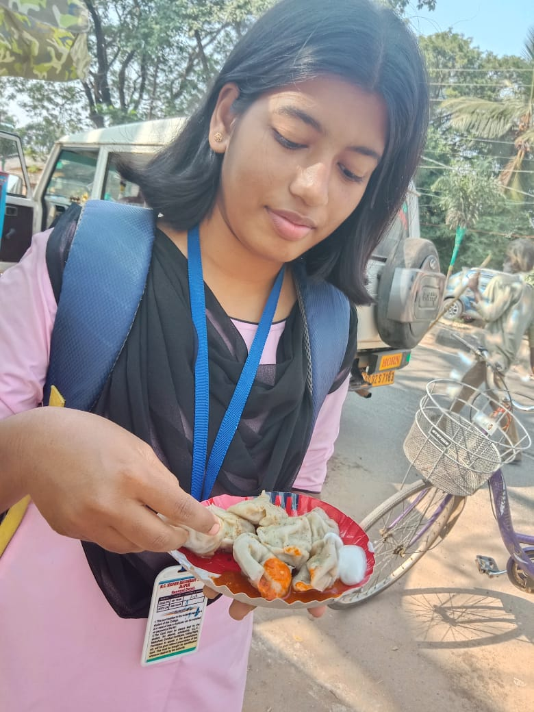

# For-Khussssssss

<!DOCTYPE html>
<html lang="en">
<head>
<meta charset="UTF-8">
<meta name="viewport" content="width=device-width, initial-scale=1.0">
<meta name="theme-color" content="#1b102b">
<title>For Khusssss ♡</title>

</head>

<body>

<header class="topbar">
  <a class="brand" href="#home">✦ For Khusssss</a>
  <nav>
    <a href="#memories">Memories</a>
    <a href="#surprises">Surprises</a>
    <a href="#wishes">Wishes</a>
  </nav>
  <button class="small-btn" id="magicToggle">✨ Magic ON</button>
  <button class="small-btn" id="musicToggle">♫ Music</button>
</header>

<audio id="music" src="Song22.mp3" loop preload="metadata"></audio>

<main>
<!-- 1-6: WELCOME EXPERIENCE -->
<section class="hero" id="home">
 

 
A little universe made just for you

 <h1>Happy Birthday, Khusssss ♡</h1>
 
For my sister, my forever friend, and one of the brightest stars in my sky.

 

  
Counting down to your special day

  
Loading birthday magic...

  
November 5, 2026

 

 <button class="primary" onclick="enterMagic()">Enter your birthday universe ✦</button>
 
SCROLL TO EXPLORE ↓

</section>

<section class="center">
 
A birthday note

 <h2>Today, the universe celebrates <em>you.</em></h2>
 
You make ordinary days warmer, memories brighter, and our family more special. This little website is a collection of love, laughter, and all the things I hope you never forget.

</section>

<!-- 7-10: MEMORIES -->
<section id="memories">
 
Chapter one · our story

 <h2>Little moments, <em>forever memories.</em></h2>
 
Your photos are waiting here. Tap any picture to see it bigger.

 

 

  <h3>Our sibling timeline</h3>
  
✦ Then
All the little beginnings that became our story.

  
♡ Along the way
The jokes, adventures, and moments only we understand.

  
∞ Always
No matter where life takes us, I’ll always be cheering for you.

 

 

  <h3>Our memory scrapbook</h3>
  <textarea id="memoryNote" placeholder="Write a favorite memory here..."></textarea>
  <button class="secondary" onclick="saveMemory()">Save memory note</button>
  

 

 

  <h3>🎬 A little memory movie</h3>
  
A video memory from your collection.

  <video id="video" controls playsinline>
   <source src="K11.mp4" type="video/mp4">
   Your browser does not support this video.
  </video>
 

</section>

<!-- 11-15: LETTER AND LOVE -->
<section id="letter" class="center">
 
Chapter two · from my heart

 <h2>A letter, <em>just for you.</em></h2>
 <button class="envelope" id="openLetter" onclick="openLetter()">
  ✉Tap to open your letter
 </button>
 <article class="panel letter hidden" id="letterContent">
  <h3>Dear Khusssss,</h3>
  
Happy birthday to the sweetest sister. I hope your days are filled with courage, peace, laughter, and people who love you exactly as you are.

  
Keep dreaming big and being your wonderful self. Whatever happens, remember you will always have me in your corner.

  
May this year bring you beautiful surprises and a thousand reasons to smile.

  
With all my love, always ♡

 </article>
 

  <h3>A message from the future</h3>
  
Dear future Khusssss: I hope you’re proud of how far you’ve come. Keep choosing joy, keep trusting your heart, and never stop believing that wonderful things are possible.

 

</section>

<!-- 16-24: SURPRISES -->
<section id="surprises">
 
Chapter three · tiny wonders

 <h2>Surprises made of <em>stardust.</em></h2>
 
Open every gift. Collect stars. Find your ultimate surprise.

 

 

  <h3>🔐 The secret treasure chest</h3>
  
Enter the birthday day number to open the chest.

  
<input id="treasureCode" placeholder="Birthday code" inputmode="numeric"><button class="secondary" onclick="unlockChest()">Unlock</button>

  

 

 

  <h3>🌌 A hidden room</h3>
  
Find the tiny star below. Tap it five times.

  <button class="secondary" id="secretStar" onclick="findSecret()">✦</button>
  
You found the secret room! You are loved more than all the stars in this universe. ♡

 

 

  <h3>✨ The magic button</h3>
  
Tap for a little burst of birthday magic.

  <button class="primary" onclick="burst(event)">Make magic ✨</button>
 

</section>

<!-- 25-30: FUN -->
<section id="play">
 
Chapter four · play time

 <h2>Let’s make a little <em>magic.</em></h2>

 

  

   <h3>🎂 Make a birthday wish</h3>
   

✦
🕯️🎂

   
Make a wish, then blow out the candle.

   <button class="primary" id="blow" onclick="blowCandle()">Blow out candle</button>
   <button class="secondary hidden" id="relight" onclick="relight()">Light it again</button>
  

  

   <h3>💫 Sister quiz</h3>
   
Which is the best part of being siblings?

   

   

   <button class="secondary" onclick="nextQuiz()">Next question</button>
  

  

   <h3>🖼 Guess the memory</h3>
   
Choose a memory and reveal a little clue.

   

    <select id="memoryChoice"><option>Memory 1</option><option>Memory 2</option><option>Memory 3</option><option>Memory 4</option></select>
    <button class="secondary" onclick="memoryClue()">Reveal clue</button>
   

   

  

  

   <h3>🗺 Birthday adventure</h3>
   
Choose a path to begin your tiny adventure.

   <button class="secondary" onclick="adventure('garden')">Garden</button>
   <button class="secondary" onclick="adventure('moon')">Moon</button>
   <button class="secondary" onclick="adventure('castle')">Castle</button>
  

 

</section>

<!-- 31-38: WISHES AND MAGIC -->
<section id="wishes">
 
Chapter five · wishes and wonders

 <h2>May your wishes <em>find their way.</em></h2>

 

  

   <h3>🏺 The birthday wish jar</h3>
   
♡

   
Tap to draw a wish from the jar.

   <button class="primary" onclick="drawWish()">Draw a wish</button>
  

  

   <h3>🌷 The birthday garden</h3>
   

    <button class="flower" onclick="flowerWish(0)">✿</button>
    <button class="flower" onclick="flowerWish(1)">✾</button>
    <button class="flower" onclick="flowerWish(2)">❀</button>
    <button class="flower" onclick="flowerWish(3)">✽</button>
   

   
Tap a flower to make it bloom.

  

 

 

  <h3>💌 Your birthday wish wall</h3>
  
Write a wish for yourself. It will float into the birthday sky.

  
<input id="wishInput" placeholder="My wish for this year is..."><button class="secondary" onclick="postWish()">Send wish</button>

  

 

 

  <h3>☔ Compliment rain</h3>
  
You are thoughtful, strong, and wonderfully you.

  <button class="secondary" onclick="complimentRain()">Let it rain compliments</button>
 

 

  <h3>🫂 A virtual hug</h3>
  <button class="hug-heart" onclick="virtualHug()">♡</button>
  
Tap the heart whenever you need a hug.

 

</section>

<!-- 39-43: 50 REASONS AND STARS -->
<section id="reasons">
 
Chapter six · all the little reasons

 <h2>50 reasons you’re <em>special.</em></h2>
 
Tap the cards to reveal the reasons. Each opened card earns a star.

 

 

  <h3>✨ Our sibling constellation</h3>
  
Tap a star to read a tiny promise.

  

  

 

</section>

<!-- 44-50: GRAND FINALE AND FEATURES -->
<section class="center" id="finale">
 
The last little chapter

 <h2>One more thing, <em>my sister.</em></h2>
 

 
No website could ever hold all the love and gratitude I have for you. I hope this birthday brings you a lifetime of reasons to shine.

 <button class="primary" onclick="finale()">Make the universe sparkle ✨</button>
 

  <h2>Happy Birthday, Khusssss! ♡</h2>
  
You are loved—today, tomorrow, and always.

  <button class="secondary" onclick="replay()">Replay birthday magic</button>
 

</section>
</main>

<footer>Made with love for Khusssss · November 5, 2026 ♡</footer>

 

</body>
</html>
